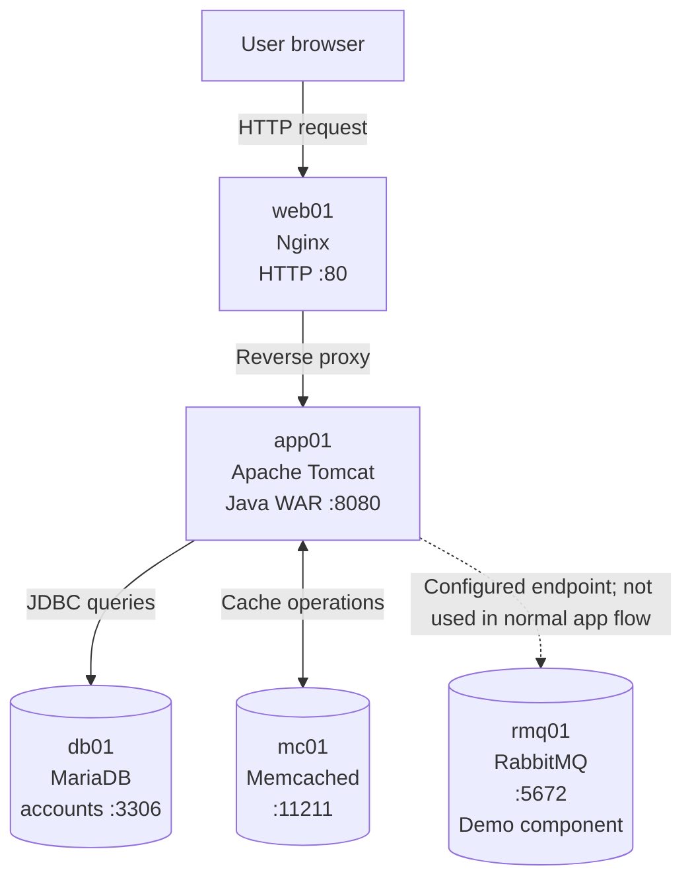
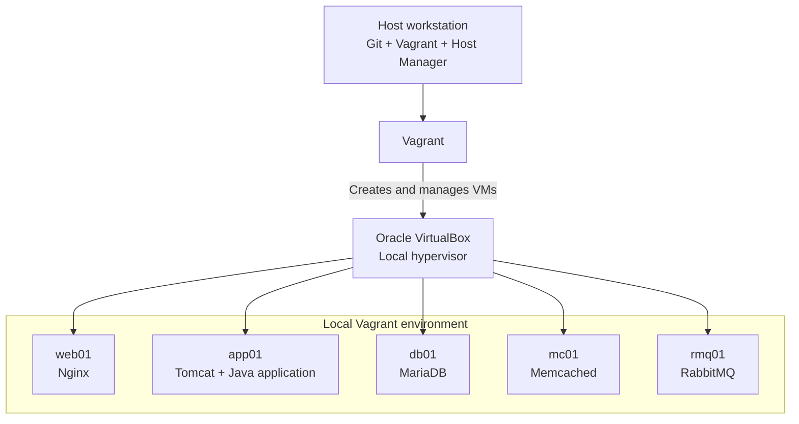

# VProfile – Architecture

## 1. Overview

VProfile is a Java-based multi-tier web application deployed in a local virtualized environment. The lab separates the web entry point, application runtime, database, cache, and demonstration message-broker service across five virtual machines.

The environment is created with Vagrant and VirtualBox. Vagrant provisions the VMs, while the Vagrant Host Manager plugin maintains hostname mappings so that services can communicate using names such as `web01`, `app01`, and `db01`.

## 2. Application architecture

### Request and data flow

1. A user opens the application using the IP address reachable on `web01`.
2. Nginx listens on TCP port 80 and forwards the HTTP request to `app01:8080`.
3. Apache Tomcat hosts the Java web application packaged as `vprofile-v2.war`.
4. The application connects to MariaDB on `db01:3306`. The application database is named `accounts` and contains the imported database dump.
5. Memcached runs on `mc01:11211` and is configured as the application's caching service. MariaDB remains the persistent database.
6. RabbitMQ runs on `rmq01:5672` as a demonstration message-broker component. The course material states that RabbitMQ is not functionally integrated into the normal application workflow in this version.

## 3. Infrastructure architecture

### Provisioning components

| Component | Role |
|---|---|
| Git | Retrieves and versions the project files |
| Vagrant | Defines and manages the local VM environment |
| Vagrant Host Manager | Maintains hostname entries for VM-to-VM name resolution |
| Oracle VirtualBox | Runs the five guest virtual machines on the host |
| Linux guest operating systems | Run the application and supporting infrastructure services |

## 4. Virtual machine responsibilities

| VM | Service | Responsibility | Application-facing port |
|---|---|---|---:|
| `web01` | Nginx | HTTP entry point and reverse proxy to Tomcat | TCP 80 |
| `app01` | Apache Tomcat | Hosts the Java web application | TCP 8080 |
| `db01` | MariaDB | Stores persistent application/account data | TCP 3306 |
| `mc01` | Memcached | Provides the caching endpoint | TCP 11211 |
| `rmq01` | RabbitMQ | Demonstrates message-broker deployment | TCP 5672 |

The setup guide uses Ubuntu package-management commands on `web01` and `dnf` on the backend service VMs. The exact guest image/version is defined by the `Vagrantfile`; the `rmq01` base-box reference was changed to `generic/rocky9` during this implementation.

## 5. Network communication

The VMs communicate over the private network configured by the Vagrant environment. Hostname resolution is provided by the Host Manager plugin, so service configuration can refer to VM names rather than hard-coded IP addresses.

| Source | Destination | Protocol / port | Purpose |
|---|---|---|---|
| Browser / host network | `web01` | HTTP TCP 80 | Open the application |
| `web01` | `app01` | HTTP TCP 8080 | Nginx reverse-proxy traffic |
| `app01` | `db01` | MySQL/MariaDB TCP 3306 | Database access |
| `app01` | `mc01` | Memcached TCP 11211 | Cache access |
| `app01` | `rmq01` | AMQP TCP 5672 | Configured broker endpoint; not part of the normal functional flow in this course version |

The deployment encountered firewall blocks on TCP 8080 and TCP 3306. Those ports were opened on `app01` and `db01`, respectively. Firewalls on `mc01` and `rmq01` were disabled as lab workarounds; a hardened implementation should keep them enabled and allow only the required source hosts and ports.

## 6. Application configuration relationships

The application configuration in `src/main/resources/application.properties` defines the following service names and ports:

| Configuration | Value used by this lab |
|---|---|
| JDBC endpoint | `jdbc:mysql://db01:3306/accounts` |
| Memcached active endpoint | `mc01:11211` |
| Memcached standby endpoint | `127.0.0.2:11211` (loopback placeholder; not a sixth VM) |
| RabbitMQ endpoint | `rmq01:5672` |

The database dump is imported into the `accounts` database. The Maven project is packaged as a WAR and deployed to Tomcat as the root application (`ROOT.war`).

## 7. Components and limits of this lab design

### Nginx is acting as a reverse proxy

The current Nginx upstream configuration contains one backend target: `app01:8080`. It provides a web entry point and reverse proxying, but it does not demonstrate load distribution across multiple Tomcat instances or high availability.

### RabbitMQ is a demonstration component

RabbitMQ is installed and configured on its own VM, but the course version describes it as a dummy/non-functional integration. It should not be represented as a required dependency for the demonstrated login flow.

### Elasticsearch is not a provisioned VM in this topology

The application build/configuration contains Elasticsearch-related dependencies and properties, but the five-VM manual provisioning workflow does not define a dedicated Elasticsearch VM or a corresponding service setup step. It is therefore not shown as an active node in the architecture above.

### This is not a production architecture

The lab is designed for local learning and repeatable experimentation. It does not demonstrate TLS termination, production secret management, firewall least-privilege rules, multiple application instances, database replication, clustered caching, broker clustering, monitoring, or high availability. Those would need separate design and implementation work before any production use.

## 8. Related documentation

- [Deployment guide](DEPLOYMENT.md) – VM provisioning and service configuration steps.
- [Troubleshooting guide](TROUBLESHOOTING.md) – errors encountered, diagnostic commands, and resolutions.

